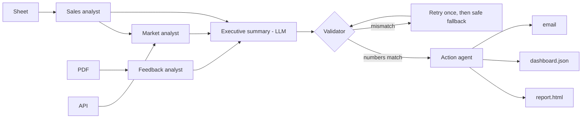

# Multi-Agent AI System: Automated Business Intelligence Report

A multi-agent AI system that **retrieves** data from three different sources, **analyses and summarises** it with an LLM,
**fact-checks** the result, and **acts** by producing a report, a dashboard file and an email draft, with no manual steps.

Built as the final project of an AI Agents course (Week 6: *Developing a Multi-Agent AI Agent System*).

## Demo

* **Demo video (architecture and live run):** [Watch the demo](https://drive.google.com/file/d/1KL4UVGBZWZGQs-ShiV8PUlauwMD95so3/view)
* **Browser demo:** download `web/agent-demo.html` and double-click it (see [Browser demo](#browser-demo)).

### Example output

Executive summary generated from the sample data (`python run.py --mock`):

```text
Revenue reached 236,290 with Cairo leading and Laptop as the best product.

### Key findings
- Cairo generates 36.6% of revenue; Delta is the weakest region.
- Revenue is down 24.1% in 2026-09 versus the previous month.
- Customers rate us 3.15 out of 5 with 40% negative comments; main pain point: delivery.
- At 54.39 EGP per USD the revenue equals about 12,850,675 EGP.

### Recommendations
- Run a growth campaign in Delta and for Headset.
- Prioritise fixing delivery issues, the biggest source of complaints.
- Review pricing against currency movements every month.
```

The EGP figure depends on the live exchange rate at run time. The agents also write `output/report.html` (with charts), `output/dashboard.json` and `output/email.eml`.

## What it does

| Input | Agent | Output |
|---|---|---|
| Sales table (CSV / Google Sheets) | `SheetRetrievalAgent` -> `SalesAnalystAgent` | revenue, best/worst region and product, monthly trend |
| Customer feedback (PDF) | `PDFRetrievalAgent` -> `FeedbackAnalystAgent` | rating, sentiment split, top complaint |
| Exchange rates (REST API) | `APIRetrievalAgent` -> `MarketAnalystAgent` | revenue converted to EGP |
| All analyses | `ExecutiveSummaryAgent` (LLM) | executive summary |
| Summary text | `ValidatorAgent` | rejects any number that is not in the source data |
| Everything | `ActionAgent` | `report.html`, `report.md`, `dashboard.json`, `email.eml` (or real SMTP) |

## Architecture



* **Stage 1 (parallel):** the three retrieval agents.
* **Stage 2:** sales and feedback analysts in parallel, then the market analyst.
* **Stage 3-5 (sequential):** summary, validation, actions.
* **Key idea:** numbers are computed in code; the LLM only explains them. A validator agent then checks every number in the text against the facts.
* **Resilience:** a failing source does not stop the run; retries and fallbacks are built in.

## Quick start

```bash
pip install -r requirements.txt
python run.py --mock        # offline demo, no API key needed
```

Open `output/report.html` in a browser.

> **Windows note:** if `python` points to a different installation than `pip`, use `py -m pip install -r requirements.txt` and `py run.py --mock`.
> Avoid the free-threaded build (`python3.14t`): numpy/pandas/pydantic do not support it.

### Use a real LLM (Claude)
```bash
export ANTHROPIC_API_KEY=sk-ant-...     # PowerShell: $env:ANTHROPIC_API_KEY="sk-ant-..."
python run.py
```
Without a key the system uses a deterministic offline writer (`MockBackend`), which is also what the tests use.

### Use your own data
| What | How |
|---|---|
| Google Sheet | publish it, then `SHEET_SOURCE="https://docs.google.com/spreadsheets/d/<ID>/export?format=csv"` (columns `date,region,product,units,revenue`) |
| PDF | `PDF_SOURCE=/path/feedback.pdf` (lines like `1. [Cairo] Rating 4/5 - text`) |
| API | `API_URL=...` (default: open.er-api.com USD rates, cached fallback when offline) |
| Real email | `SMTP_HOST`, `SMTP_USER`, `SMTP_PASS`, `EMAIL_TO` |

## Browser demo

`web/agent-demo.html` is a single-file page that runs the same pipeline in the browser. Double-click it to open.
It shows each agent running with its timing, lets you inject failures (missing feedback file, a wrong number from the writer)
and shows the report and email draft. Opened locally it uses the built-in offline writer.

## Testing and evaluation

```bash
python -m pytest -q     # 10 tests
python evaluate.py      # writes docs/EVALUATION_REPORT.md
```

| Area | Result |
|---|---|
| Reliability | 10/10 consecutive runs completed, fact check passed |
| Accuracy | 8/8 checks match an independent pandas calculation |
| Robustness | 5/5 injected failures handled: API down, PDF missing, sheet missing, LLM hallucination, LLM timeouts |
| Efficiency | parallel stages are faster than sequential (see `docs/EVALUATION_REPORT.md`) |

## Project layout

```
run.py                     entry point
evaluate.py                reliability / accuracy / efficiency evaluation
generate_sample_data.py    recreates data/ (sales.csv, customer_feedback.pdf, fallback_rates.json)
agent_system/              agents.py, orchestrator.py, actions.py, llm.py, config.py, utils.py
tests/                     pytest suite incl. failure injection
web/agent-demo.html        browser demo
docs/                      architecture notes and evaluation report
output/                    sample generated report, dashboard, email, run log
```

## Author

Built by [@Ahmeddawood324](https://github.com/Ahmeddawood324).

## Limitations and future work

* Sentiment analysis is keyword based and the sample data is small.
* Next steps: a database source, weekly scheduling, LLM-based sentiment, real email delivery by default.
